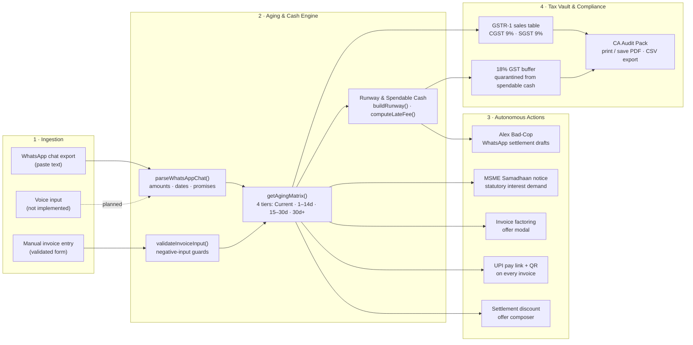

<div align="center">

**🌐 Live Production:** [https://cash-pulse-juskgo.vercel.app](https://cash-pulse-juskgo.vercel.app) · **📦 Source:** [github.com/murali007/CashPulse](https://github.com/murali007/CashPulse)

[](#-the-problem)
[](#-code-quality--test-proof)

</div>

<div align="center">

# 💠 CashPulse

### Stop working-capital mortality for India's micro-businesses.

[](#-live-demo)
[](#-code-quality--test-proof)
[](#-the-problem)
[](#-author--credits)

<sub>React 18 · Vite 5 · Tailwind CSS 3 · Express 5 · better-sqlite3</sub>

</div>

---

## 🎯 Executive Pitch

India's **63 million micro-businesses** generate the country's jobs and GDP, yet many do not die from a lack of customers. They die from a lack of **cash**. A studio or supplier delivers the work, invoices the client, and then waits 45, 60, or 90 days for payment while rent, salaries, and GST fall due on schedule.

**CashPulse** turns that invisible wait into a managed workflow. It reads the receivables a small business already has, ages them, separates real spendable cash from money that is owed but not yet collected, and takes the next action: a firm WhatsApp follow-up, an MSME Samadhaan notice, or a one-scan UPI payment.

> **One-line pitch:** CashPulse is the cash-flow co-pilot that keeps a micro-business alive between the invoice and the payment.

---

## 🔥 The Problem

| Pain point | What it does to a micro-business |
|---|---|
| **Late-paying clients** | Invoices sit in "pending" for months with no owner chasing them. |
| **No aging visibility** | The owner cannot tell a 3-day delay from a 90-day default. |
| **Tax liability looks like cash** | GST collected from clients is money the business does not own, but it looks spendable. |
| **Awkward follow-ups** | Chasing a friend or a long-term client by hand is slow and emotionally costly. |
| **Legal leverage goes unused** | The MSME Development Act gives small suppliers a right to interest on late payments, which most owners never claim. |

**Working-capital mortality** is the point at which a business with healthy sales runs out of cash to pay its own bills. CashPulse exists to push that point further away.

---

## 🏗️ Architecture & Data Flow



**Reading the flow:** raw inputs are normalised into invoice records, the aging engine places every receivable in one of four tiers, and each tier unlocks a proportionate action. Tax owed to the government is quarantined before the owner sees a "spendable" number.

> **Honesty note:** the aging engine, WhatsApp parser, GST math, and validation are real logic. Client, invoice, and bank data are seeded from `src/data/mockData.js`, and the copilot and some demo content use canned text. Voice input is not implemented; the app uses speech synthesis only, to read the morning briefing aloud.

---

## ✨ Comprehensive Feature Matrix

| # | Feature | What it does | Where it lives | Status |
|---|---|---|---|---|
| 1 | **WhatsApp chat ingestion** | Parses pasted WhatsApp chat text, extracting ₹ / Rs / INR / "k" amounts, dates, and payment promises. | `src/utils/whatsappParser.js` | ✅ Real logic |
| 2 | **Four-tier aging engine** | Buckets every invoice into Current, 1–14d, 15–30d, or 30d+ overdue, with totals per tier. | `src/utils/finance.js` (`getAgingMatrix`) | ✅ Real logic |
| 3 | **Receivables command centre** | Tier cards, invoice lists sorted by due date, and status per invoice. | `src/pages/ReceivablesInvoices.jsx` | ✅ Real UI on mock data |
| 4 | **Cash runway & scenarios** | Projects runway and compares scenarios from receivables and burn. | `src/utils/finance.js` (`buildRunway`, `buildRunwayScenarios`) | ✅ Real logic |
| 5 | **Alex Bad-Cop settlement drafts** | "Alex – Automated Settlement Protocol" WhatsApp messages in selectable tones. | `src/components/receivables/WhatsAppModal.jsx` | ✅ Message composer (templated) |
| 6 | **MSME Samadhaan notice** | Drafts a late-payment demand that cites MSME Samadhaan and computes late interest. | `src/components/MSMENoticeModal.jsx`, `computeLateFee()` | ✅ Draft generator |
| 7 | **Settlement discount offer** | Offers an early-payment discount to pull a late invoice in faster. | `src/components/modals/DefendRentModal.jsx` | ✅ Composer (templated) |
| 8 | **Invoice factoring offer** | Shows what a factoring partner would advance against an invoice. | `src/components/InvoiceFactoringModal.jsx` | 🟡 UI prototype |
| 9 | **UPI pay link + QR on invoices** | Builds a `upi://pay` deep link and a scannable QR for each INR invoice. | `src/components/receivables/InvoiceModal.jsx` | ✅ Real (QR via external QR service) |
| 10 | **Bank reconciliation** | Matches statement credits to open invoices by client name and exact amount, then marks them paid. | `src/components/BankReconcilerModal.jsx` | ✅ Real logic on sample statement |
| 11 | **GST buffer & escrow vault** | Quarantines an 18% GST buffer (₹16,380 in the demo) from spendable cash, and shows an escrow-style deliverables vault on invoices. | `src/components/CAAuditPackModal.jsx`, `receivables/InvoiceModal.jsx` | ✅ Computed / 🟡 vault is presentational |
| 12 | **GSTR-1 sales table & CSV export** | CGST 9% + SGST 9% per invoice, totals row, and a client-side CSV download of all invoices. | `src/components/CAAuditPackModal.jsx` | ✅ Real logic |
| 13 | **CA Audit Pack** | Print-ready "Monthly CA Audit & GSTR-1 Pack" with executive summary and MSME debtors schedule. | `src/components/CAAuditPackModal.jsx` | ✅ Print / save as PDF via browser |
| 14 | **Input validation** | Rejects blank names, zero or negative amounts, NaN, and missing or invalid due dates. | `src/utils/validation.js` | ✅ Tested |
| 15 | **Morning briefing** | Daily cash summary with read-aloud via the browser speech synthesis API. | `src/components/MorningBriefing.jsx` | ✅ Text-to-speech only |
| 16 | **AI copilot widget** | Chat panel for cash questions. | `src/components/copilot/CopilotWidget.jsx` | 🟡 Canned keyword replies |
| 17 | **Client risk profiles** | Risk tier and payment-velocity trend per client. | `src/utils/clientRisk.js` | ✅ Real logic on mock data |

<sub>✅ implemented and working · 🟡 prototype or presentational</sub>

---

## 🧪 Code Quality & Test Proof

### Test suite
- **Framework:** Vitest 2 (`vitest run`), run through `npm test`.
- **Result on the last run:** `tests/finance.test.js`: **26 of 26 tests passing**, 0 failures, about 0.6 s.
- **Coverage of the suite:**
  - Aging and receivables logic (tier boundaries, totals, outstanding amounts).
  - Runway and scenario calculations.
  - Late-fee computation.
  - **Validation suite (11 cases):** 9 single-field rejections (empty or whitespace-only client name, zero or negative amount, missing or `NaN` amount, amount below the ₹1 minimum, missing or empty due date), one check that every invalid field is reported at once, and one check that a complete invoice is accepted.

### Negative-input handling
Invoices are checked by `validateInvoiceInput()` before they are used in calculations. Invalid records are rejected with a specific message rather than being silently coerced into a wrong cash figure. Money is formatted through the shared `formatINR()` helper.

### Build verification
- `npm run build` completes with exit code 0 (Vite production build).

### Engineering practices
- Pure calculation logic lives in `src/utils/` with no UI dependencies, so it can be tested in isolation.
- Business rules (aging, GST, late fees, validation) are separated from presentation components.
- Compliance-sensitive outputs (GST split, CA pack totals) are computed in one place and reused by the screen, the print view, and the CSV export.

---

## ⚙️ Setup & Verification

### Prerequisites
- Node.js 18 or newer
- npm (bundled with Node)

### 1. Install and run locally
```bash
cd cashpulse-ai
npm install
npm run dev
```
Open the URL printed in the terminal (Vite defaults to `http://localhost:5173`).

### 2. Run the test suite
```bash
cd cashpulse-ai
npm test
```
Expected: `Tests  26 passed (26)`.

### 3. Create a production build
```bash
cd cashpulse-ai
npm run build
npm run preview
```

### Environment
No environment variables are required to run the demo. The UPI demo uses the placeholder payee `ravi@upi`, and the QR image is generated by an external QR service, so it needs internet access.

---

## 🚀 Live Demo

| Resource | Link |
|---|---|
| Live app (Vercel) | `https://<your-vercel-url>` |
| Demo walkthrough video | `<add link>` |
| Pitch deck | `<add link>` |

> Replace the placeholders above with the deployed URL before presenting.

---

## 👤 Author & Credits

**Muralidhar Yerram** designed and built CashPulse.

Built on **Codebenders** for **Problem Statement 1**.

---

<div align="center">

**CashPulse** · Keep the cash moving.

</div>
